## 👤 About Me

  

I work where **security operations meets agentic AI**. My days are spent triaging alerts, hunting threats in KQL and working vulnerability findings. Then I build AI agents that take over the repetitive parts so analysts can spend their time on real threats.

---

## 🎯 What I'm Into

- **🔍 Threat hunting & detection.** Weekly KQL hunts across Defender Advanced Hunting, Sentinel and Entra sign-in logs: chasing IOCs and exploitation patterns, then mapping what I find to MITRE ATT&CK.
- **🛡️ Vulnerability management.** Taking findings from Wiz, Endor Labs SAST/SCA and HackerOne, checking them against the actual code paths, and prioritizing by reachability, EPSS and CVSS.
- **🤖 Agentic AI for security.** Building triage agents and multi-agent pipelines (Copilot Studio + MCP) that pull intel together, cut false positives and draft hunt queries.

> Short version: I want to **automate the boring parts of security** so the hard parts get the attention they deserve.

---

## 🏅 Competitions

| Competition | Result |
|---|---|
| 🎯 NCL Spring 2026 (Individual) | **Top 250 / 7,008** · 81% accuracy |
| 🛡️ NCAE Cyber Defense Games 2026 | **2nd overall · 1st infrastructure uptime** (blue-team defense) |
| 🎯 NCL Fall 2025 / Spring 2025 | Top 642 / 7,876 · Top 923 / 8,575 |

---

## 🛠️ Skills

**Security Operations** · Microsoft Defender · Sentinel · KQL · GreyMatter · Wiz · HackerOne · Endor Labs · MITRE ATT&CK · Wireshark · Nmap
**Agentic AI & Automation** · Copilot Studio · MCP · Python · PowerShell · Microsoft Graph API · GitHub Actions · Jira · Confluence
**Cloud & Identity** · Azure · Entra ID · Intune · AWS · Docker

---

  

