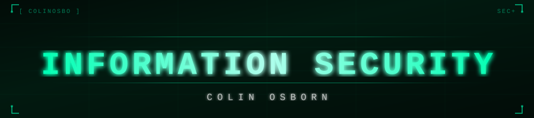

<div align="center">




<br/>

[](https://linkedin.com/in/colinosborn2002/)
[](https://cp.certmetrics.com/comptia/en/public/verify/credential/fcc7a3c9e949462ca24b965d463484bb)

</div>

---

## 👤 About Me

```yaml
name:      Colin Osborn
currently: Cybersecurity Intern (DevSecOps) @ CCC Intelligent Solutions
focus:     DevSecOps automation · Cloud security · Detection & response
education: B.S. Cybersecurity @ Illinois State University
cert:      CompTIA Security+
```

I sit where **security engineering meets security operations** — building the automation and cloud tooling that make defense scale, then using it to catch and respond to real threats. Blue-team instincts, engineer's toolbox.

---

## 🎯 What I'm Into

- **⚙️ DevSecOps & security automation** — automating vulnerability workflows end-to-end: Wiz→Jira ticketing, SAST/SCA triage, and risk-based prioritization so findings reach the right team fast.
- **☁️ Cloud security (AWS & Azure)** — tuning cloud vuln findings, identity & access (RBAC / role-mining), endpoint hardening, and securing the pipeline itself (OIDC, image scanning, digest-pinned deploys).
- **🔍 Detection & threat hunting** — writing and tuning detections, hunting across logs, and mapping activity to MITRE ATT&CK.

> Short version: I want to **automate the boring parts of security** so the hard parts get the attention they deserve.

---

## 💼 Experience

**🏢 Cybersecurity Intern — DevSecOps · CCC Intelligent Solutions** *(May 2026 – Present · Chicago, IL)*
> Security engineering across an enterprise program protecting a cloud platform that connects **35,000+ businesses**.
> - **Built automated vulnerability ticketing between Wiz and Jira** — creating, enriching, linking, and routing findings to the right engineering teams, cutting manual triage and supporting the Jira migration.
> - **Triaged AI SAST/SCA findings** across Java & Python via GitHub code-path review — validated true positives and documented suppressions for **130+ false-positive criticals** and **3,000+ orphaned vulnerabilities**; cut Wiz noise by filtering out AWS auto-scaling groups.
> - Supported **Saviynt RBAC & role-mining** by cleansing and validating Workday identity data to drive accurate role recommendations and access provisioning.

**🖥️ Intune System Administrator — Tech-Zone** *(Nov 2025 – May 2026)*
> Automated patch management and enforced least-privilege policy across **2,000+ endpoints** via Microsoft Intune.

**🎧 IT Support Analyst — Technology Support Center** *(May 2025 – May 2026)*
> Identity-management automation with Ansible, compromised-account recovery, and ServiceNow ticketing.

---

## 📁 Featured Projects

**⚙️ [CI/CD Pipeline — DevSecOps Case Study](https://github.com/colinosbo/covisor-cicd-pipeline)**
Hardened GitHub Actions pipeline for a full-stack app: test gate, Trivy image scanning, **OIDC (keyless) cloud auth**, digest-pinned deploys, and reviewer-gated, health-checked releases.

**🤖 [Recon AI Agent](https://github.com/colinosbo/IT_359_Project)**
Autonomous recon agent that pipes Nmap output into a local LLM (Llama 3.2) to surface attack paths and misconfigurations, then generates structured remediation reports. *(Python)*

**📧 [Email-Forensics-Automation](https://github.com/colinosbo/Email-Forensics-Automation)**
Automated email threat analysis — SPF/DKIM validation, IOC enrichment, and malicious/benign classification. *(Python · Microsoft Graph API · VirusTotal)*

**🔒 [SOC-LetsDefend](https://github.com/colinosbo/SOC-LetsDefend)**
20+ real alerts triaged across phishing, malware, ransomware, and network intrusion — with MITRE ATT&CK mapping and IR writeups.

---

## 🏅 Competitions

| Competition | Result |
|---|---|
| 🎯 NCL Spring 2026 (Individual) | **Top 250 / 7,008** · 81% accuracy |
| 🛡️ NCAE Cyber Defense Games 2026 | **2nd overall · 1st infrastructure uptime** (red-team defense) |
| 🎯 NCL Fall 2025 / Spring 2025 | Top 642 / 7,876 · Top 923 / 8,575 |

---

## 🛠️ Skills

<div align="center">

[](https://skillicons.dev)

</div>

**DevSecOps & Automation** · Wiz · Jira · SAST/SCA · GitHub Actions · Docker · Python · PowerShell · Ansible
**Cloud & Identity** · AWS · Azure · Intune · Saviynt · Active Directory · Microsoft Graph API
**Security Operations** · Splunk · Wireshark · Nmap · MITRE ATT&CK · Snort

---

<div align="center">


<br/><br/>

[](https://linkedin.com/in/colinosborn2002/)

</div>
